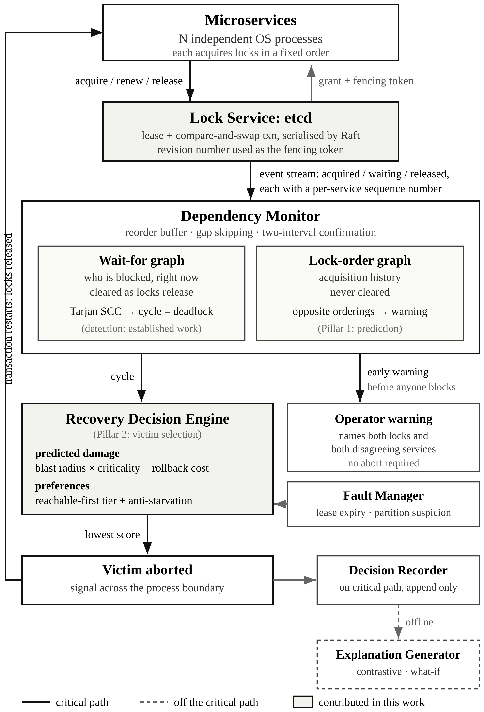
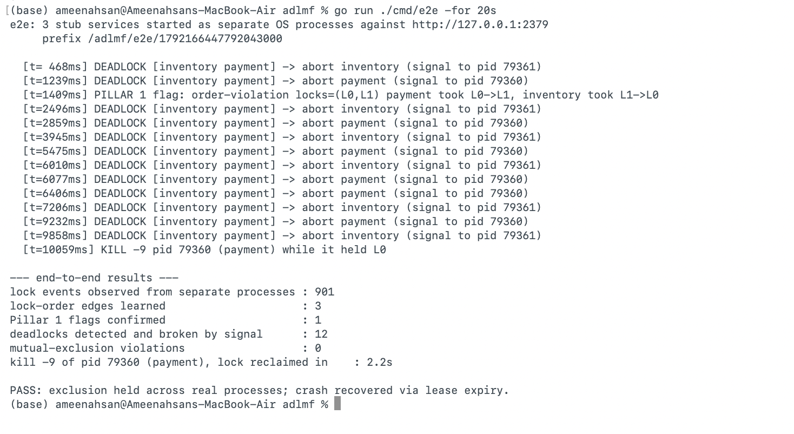
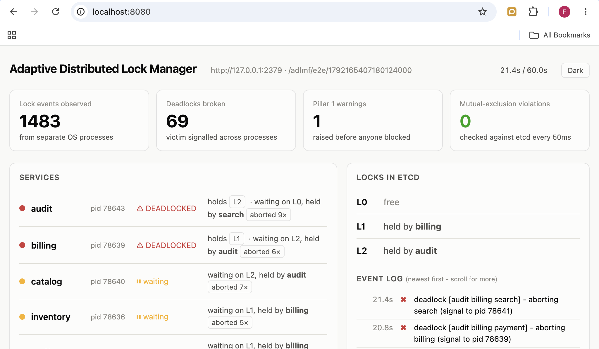

# Adaptive Distributed Lock Management Framework

Predicting and recovering from distributed deadlocks when the monitor cannot see
everything.

Fida Shameer (24BAI0180) and Avanti Golatkar (24BKT0119)
School of Computer Science and Engineering, Vellore Institute of Technology
BCSE303P Operating Systems Lab

---

## What this is

A deadlock happens when two or more services each hold something the others need.
Nobody can move and the situation does not clear on its own, so one participant has
to be killed and its work thrown away.

Detecting the cycle has been a solved problem since the 1980s. Deciding *who to
kill* has had much less attention, and the answers that exist were written for a
single database. This project works on two things that single-database answers do
not cover.

**Prediction.** If one service consistently takes lock A then lock B while another
takes B then A, those two will deadlock as soon as they overlap. That is knowable
from acquisition history alone, before anyone blocks. Tools like lockdep do this
inside one process, where every lock operation is seen immediately and in order.
Across a network, observations arrive late, out of order, or not at all, and that
turns out not to be a minor relaxation.

**Victim selection.** The usual rule picks whichever candidate is cheapest to roll
back, looking at each one in isolation. In a connected system the cheapest
candidate may be the one the largest number of other services are waiting on. This
framework scores candidates by a criticality-weighted blast radius instead: the
victim plus everything transitively queued behind it.



One event stream feeds two structurally different records. The wait-for graph is
reactive and cleared as locks release. The lock-order graph is historical and never
cleared, because the dangerous pattern is in the past and the evidence has to
outlive the locks it concerns.

---

## Running it

Needs Go 1.24 or later and etcd. Nothing else. No external Go dependencies.

```sh
brew install go etcd          # macOS
```

Start etcd in its own terminal and leave it alone:

```sh
etcd --listen-client-urls http://127.0.0.1:2379 \
     --advertise-client-urls http://127.0.0.1:2379
```

Then:

```sh
go test ./... -count=1                  # 36 tests, 5 of them against the live etcd
go run ./cmd/e2e -for 20s               # real OS processes, real etcd, real SIGKILL
go run ./cmd/experiments -trials 20     # all ten experiments, about 8 minutes
```

Everything that needs etcd skips itself cleanly when nothing is listening on
`127.0.0.1:2379`, rather than falling back to a fake lock service and reporting a
pass.

`SETUP.md` has the longer version, including what to do when something fails.

### The end-to-end demo

`cmd/e2e` starts each service as its own operating system process, watches lock
state directly in etcd every 50 ms, and compares that against what the services
report. It is not a program checking itself.



Twelve deadlocks detected and broken by signalling a victim across a process
boundary, one lock-order warning raised before anyone blocked, and no exclusion
failures. Note that the victim alternates rather than settling on one service.
That is the anti-starvation term working, and it turns out to be the single most
important part of the design.

Halfway through, the harness sends `SIGKILL` to a process holding a lock. Nothing
in the framework detects the crash. The lease simply expires and etcd hands the
lock back about two seconds later.

Useful flags:

```sh
go run ./cmd/e2e -for 20s -services 10         # 2 to 50 services
go run ./cmd/e2e -for 60s -services 10 -http :8080   # live dashboard at localhost:8080
```



`audit` holds L2 and waits on L0, while `billing` holds L1 and waits on L2, which
`audit` holds. That pair of rows is what a deadlock looks like from the outside.

---

## What we found

Ten experiments, twenty seeded trials each, 95% confidence intervals. A difference
is only reported as real where the intervals do not overlap. Full numbers in
`RESULTS.txt`, the write-up in `paper/IEEE_Paper.pdf`.

Everything in the table below comes from the seeded simulator. The same comparison
was later run against real operating-system processes and a live etcd, and the two
do not agree on all of it. That run is in `results/REAL-HARNESS.txt` and is read
out under [Simulator against real processes](#simulator-against-real-processes)
below. `paper/IEEE_Paper.pdf` is the version submitted at Review 2 and predates it.

| | Hypothesis | Outcome |
|---|---|---|
| H1 | Disruption vs cost-only | 3.5% **worse**, separated at 95% |
| H2 | Recovery time vs timeout | 65 to 84% faster at every level |
| H3 | Framework overhead | 0% throughput, +49% CPU |
| H4 | Crash and stale-lock recovery | 0 double-grants, 20/20 progressed |
| H5 | Prediction quality | Precision 1.000, recall 1.00 to 0.725 |
| H6 | Explanation recording cost | +1.02%, inside trial noise |
| H7 | Victim-selection ablation | Fairness term gives about 3x throughput, in the simulator |
| H8 | Partition handling | 22.9 futile abort episodes down to 0 |
| H9 | Self-calibration | **Loses on its own training target** |
| H10 | Deadlock frequency | Best at every contention level |

Three of these are worth reading properly.

**Blast radius on its own is destructive.** At 30 and 60 services it completes one
or two transactions against the prior art's 111 to 113, while simultaneously
posting the best disruption figure anywhere in the suite. It keeps picking the same
low-cost victims and those victims never finish. This is the clearest illustration
we have of why a policy must not be judged on the metric it optimises, and it is
why every mechanism here is evaluated against something it does not itself try to
improve.

**Prediction is accurate but mistimed.** It never raised a false warning in any
condition tested, including 15% message loss. But its lead time inverts with
contention and goes negative under heavy load, because the check needs a service to
successfully complete an out-of-order acquisition before any evidence exists, and
under heavy load that service deadlocks on its first attempt. It pays off only
where contention is light, which is also where deadlocks cost the least.

**Self-calibration does not work, and we can say why.** The only quantity
observable after an abort is the work destroyed, which does not depend on blast
radius, so a correct regression drives the blast-radius weight to zero. But blast
radius is what governs throughput. The failure is in where a correct learner must
converge, not in how it converges. It ships switched off
(`recovery.DefaultAlpha = 0`).

### Simulator against real processes

Seeded runs answer whether a difference survives the seed. They do not answer
whether it survives an operating system. The policy comparison was repeated
against twenty stub services, each its own process, talking to a real etcd. Those
runs are not seeded, so every difference has to hold up against scheduling
variance. Numbers in `results/REAL-HARNESS.txt`.

**The threefold throughput figure does not transfer.** Across 98 trials at two
contention levels, no policy separates from any other on completed transactions.
The intervals overlap in both configurations, so no win is claimed. At the heavier
setting adaptive completes 20.7 transactions against the timeout baseline's 10.8,
a factor of 1.9 rather than 3, and blast-only (23.2) and cost-only (21.9) both
finish ahead of it.

**The fairness term does transfer, and it is the part worth keeping.** Over 45
trials with 20 services contending for 3 locks, counting what share of all aborts
landed on the single worst-affected service:

| policy | aborts falling on the worst-hit service | against a 5% fair share |
|---|---|---|
| blast-only | 24.7% | 4.9x |
| cost-only | 12.7% | 2.5x |
| adaptive | 10.2% | 2.0x |

Adaptive against cost-only is 2.50 percentage points lower with a 95% interval of
[0.68, 4.32], so the two separate. Against blast-only the gap is 14.5 points.
Both figures come straight out of `results/starvation-trials.tsv`, whose columns
are configuration, policy, completed, deadlocks, exclusions, and the number of
aborts falling on the worst-affected service.

So the mechanism this project argues for holds up outside the simulator and the
throughput headline attached to it does not. Which of the remaining simulator
results survive the same treatment is open, and is what the next phase is for.

### Two defects in our own measurement

Both are written up in the paper rather than quietly fixed.

The simulator was handing the policy ground truth. Rollback cost was read from true
service state instead of from delivered events, so the estimate the policy reasoned
about was exactly the work its abort went on to destroy. After fixing it and
re-running everything, H1 flipped from a win into a 3.5% loss. That result is
reported unchanged.

The demonstration harness counted a lock as suspiciously held whenever its holder
was missing from the live service map, and the crash-injection path removes the
killed service from that map. A victim holding more than one lock therefore produced
spurious counts for the gap between its two leases expiring. It needed a machine
slow enough for those expiries to separate by more than one polling interval, which
is why it showed up on one laptop and not another.

Both are the same shape: a measurement reading state that the thing being measured
has already changed.

---

## Layout

```
depmonitor/     wait-for graph (detection) and lock-order graph (prediction)
recovery/       victim selection, plus the three baselines it is compared against
lockservice/    etcd backend, leases, fencing tokens, and an in-memory backend
faultmgr/       lease expiry and partition suspicion
explain/        contrastive explanations of recovery decisions, off the critical path
benchmark/      the deterministic simulator and all ten experiments
cmd/e2e/        end-to-end demo against real processes and real etcd
cmd/experiments/  runs the experiments and prints RESULTS.txt
cmd/stubservice/  one service, as its own OS process
paper/          the write-up as submitted at Review 2, its figures, and its build script
results/        the unseeded real-process runs: policy comparison and starvation trials
docs/           scope audit against the Review 1 report
```

`PROJECT-GUIDE.md` explains the design decisions and why each alternative was
rejected. `DEMO-SCRIPT.md` is the walkthrough used for the live demonstration.

---

## Reproducibility

Every simulator experiment is seeded. The full suite was run on Linux under Go
1.24.7 and on macOS under Go 1.27.1 and the output compared. The only quantities
that differ between machines are the two wall-clock measurements in H3 and H6,
which are elapsed-time figures and vary run to run on the same machine as well.

The real-process runs under `results/` are a different matter. They are not
seeded, they do not reproduce exactly, and they are reported as means with 95%
intervals for that reason.

## Licence

MIT. See `LICENSE`.
